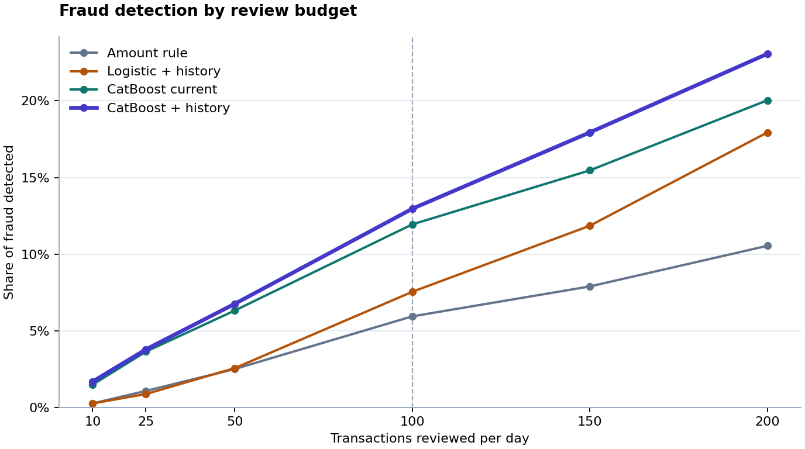

# Транзакционный антифрод с лимитом проверок

При бюджете **100 проверок в день** CatBoost с историей платежей нашёл **445 мошеннических операций** на реальных данных Vesta. Та же модель с признаками только текущего платежа нашла **410**. История дала **35 дополнительных обнаружений** и столько же сокращённых проверок легитимных платежей.

**Стек** · Python 3.12 · DuckDB и SQL · scikit-learn · CatBoost

## Результаты

Тестовый период — 35 дней, 99 985 транзакций, из них 3 434 мошеннические. Каждый метод отобрал 3 500 операций.

| Метод | Найдено случаев фрода | Полнота | Точность алертов | Доля суммы фрода в алертах |
|---|---:|---:|---:|---:|
| Правило по сумме | 204 | 5,94% | 5,83% | **36,88%** |
| Логистическая регрессия с историей | 259 | 7,54% | 7,40% | 16,46% |
| CatBoost на текущем платеже | 410 | 11,94% | 11,71% | 20,88% |
| **CatBoost с историей** | **445** | **12,96%** | **12,71%** | 17,21% |



- **Число случаев и сумма дают разный ответ.** CatBoost с историей обнаружил больше всего мошеннических операций. Правило по сумме чаще отбирало крупные мошеннические платежи и охватило максимальную долю их общей суммы. Это объём фрода в очереди, а для оценки предотвращённых потерь нужны исходы проверок.
- **Лимит зависит от политики отбора.** Дневной топ‑100 соблюдал бюджет каждый день. Фиксированный порог, настроенный на валидации под 100 проверок в среднем, на тесте дал CatBoost с историей в среднем 105 проверок, с пиком 182. Топ‑100 формируется по итогам дня.
- **Эффект истории измерен отдельно.** У двух моделей CatBoost одинаковые настройки и временные границы. Добавление истории подняло Average Precision с 0,0712 до 0,0928.

[Полные метрики](reports/ieee/metrics.csv) · [Данные графика](reports/ieee/budget_curve.csv) · [Анализ обучающей выборки](reports/ieee/train_profile.csv)

## Как устроен эксперимент

1. **Импорт и анализ.** Загружаю размеченный `train_transaction.csv` из IEEE‑CIS Fraud Detection в DuckDB. Всего 590 540 реальных обезличенных транзакций Vesta. Доля фрода — 3,50%. На обучении доля фрода среди платежей без операций за предыдущие сутки составляла 4,22%, среди платежей с четырьмя и более предшествующими операциями — 2,70%. [Источник данных](https://www.kaggle.com/competitions/ieee-fraud-detection/overview) · [Файлы Kaggle](https://www.kaggle.com/competitions/ieee-fraud-detection/data)
2. **Поведенческие признаки в SQL.** Считаю количество операций за предыдущий час, сутки и неделю, среднюю сумму за неделю, отношение суммы платежа к этой средней и время с предыдущей покупки. Учитываю только строго более ранние платежи. [SQL-запрос](sql/features.sql)
3. **Разделение по времени.** Первые семь суток использую для накопления истории. Оставшийся период делю на train, validation и test приблизительно в пропорции 65/15/20 по дням. На train обучаю модели, на validation выбираю порог, на test сравниваю модели при одинаковом бюджете. История платежей продолжается через границы периодов. Метки в обучающей выборке считаются известными к моменту обучения.
4. **Пакетный скоринг.** Сохраняю CatBoost с историей и проверяю, что команда скоринга выгружает балл риска, ранг и решение о ручной проверке для каждой операции выбранного дня.

### Как определена история

Подтверждённого ID клиента в данных нет. Вместо него группирую платежи по совпадению `card1`, `card2`, `card3`, `card5` и `addr1`. Этот ключ может объединять разных покупателей или разделять историю одного покупателя. У 74 115 операций (12,6%) отсутствует хотя бы одно из обязательных полей `card1`, `card2` или `addr1`, поэтому их история пуста. Время в IEEE‑CIS дано в секундах от неизвестной точки отсчёта. Даты в командах и файлах относительные, с условным началом `1970-01-01`.

## Как воспроизвести

Проверено с Python 3.12. Скачай `train_transaction.csv` в своём аккаунте Kaggle, распакуй его в `data/` и выполни команды из корня репозитория. [Страница загрузки](https://www.kaggle.com/competitions/ieee-fraud-detection/data?select=train_transaction.csv)

```bash
python3 -m venv .venv
source .venv/bin/activate
python -m pip install -r requirements.txt

python prepare_data.py --ieee-csv data/train_transaction.csv
python fraud.py experiment --dataset ieee --budget 100
python fraud.py score-day --dataset ieee --date 1970-07-02 \
  --budget 100 --output artifacts/ieee_review.csv
python -m unittest discover -s tests -v
```

Скрипты создают базу DuckDB в `data/`, обученную модель и очередь в `artifacts/`, метрики и график в `reports/ieee/`. Репозиторий содержит исходный код, тесты и агрегированные результаты. Файлы с отдельными операциями и модель хранятся локально.

<details>
<summary>Дополнительный эксперимент на симулированных данных</summary>

На первом этапе я проверил тот же пайплайн на симуляции Fraud Detection Handbook. За 38 тестовых дней при том же дневном бюджете CatBoost с историей нашёл 960 случаев, CatBoost на текущем платеже — 810, правило по сумме — 818. Их абсолютные метрики отражают другой набор данных и сценарии генератора.

```bash
python prepare_data.py
python fraud.py experiment
```

[Описание симулятора](https://fraud-detection-handbook.github.io/fraud-detection-handbook/Chapter_3_GettingStarted/SimulatedDataset.html) · [Версия набора](https://github.com/Fraud-Detection-Handbook/simulated-data-raw/tree/6e67dbd0a3bfe0d7ec33abc4bce5f37cd4ff0d6a) · [Метрики](reports/metrics.csv) · [Разбивка по сценариям](reports/scenarios.csv)

</details>
